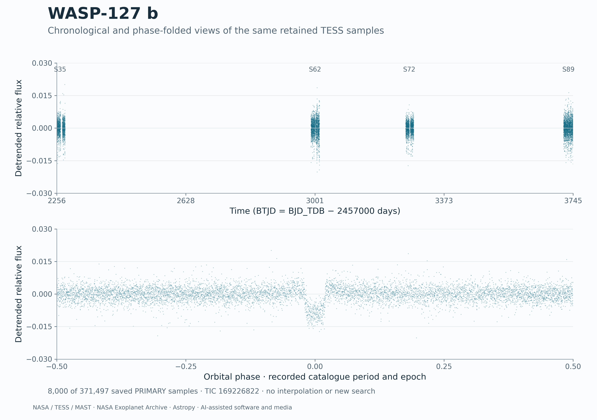
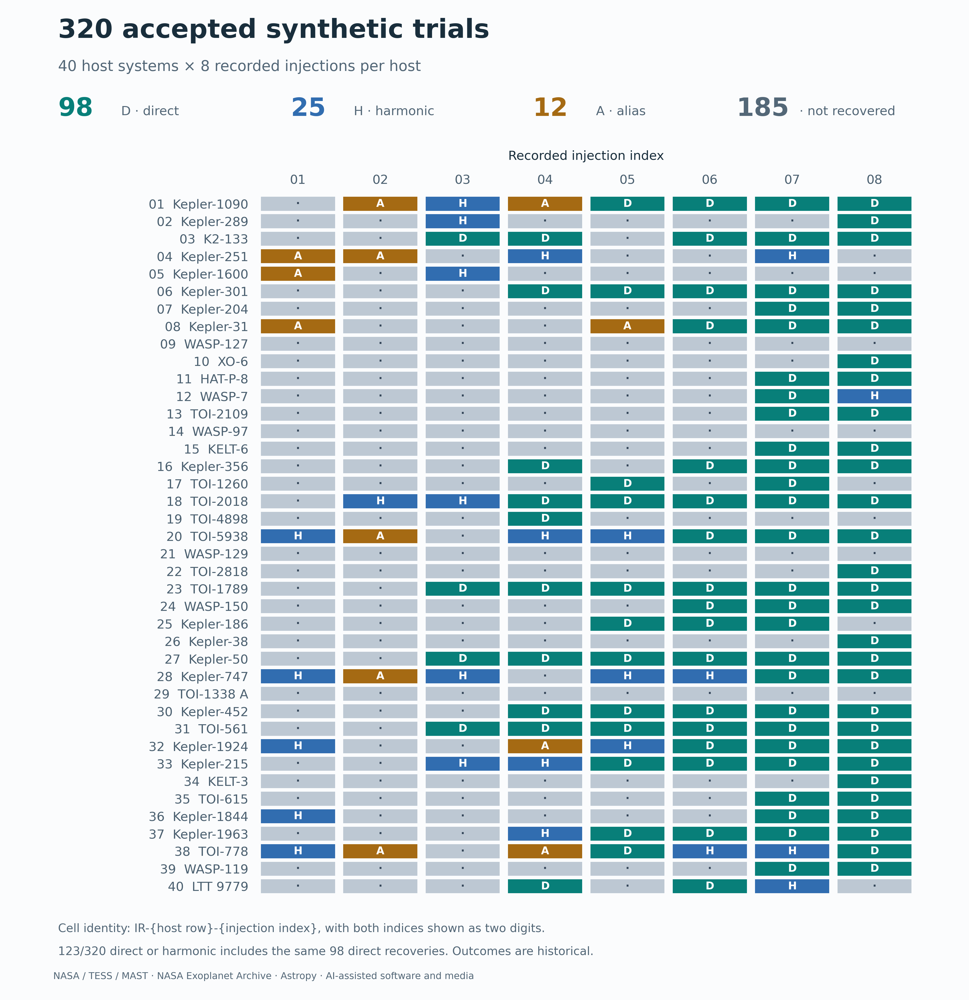
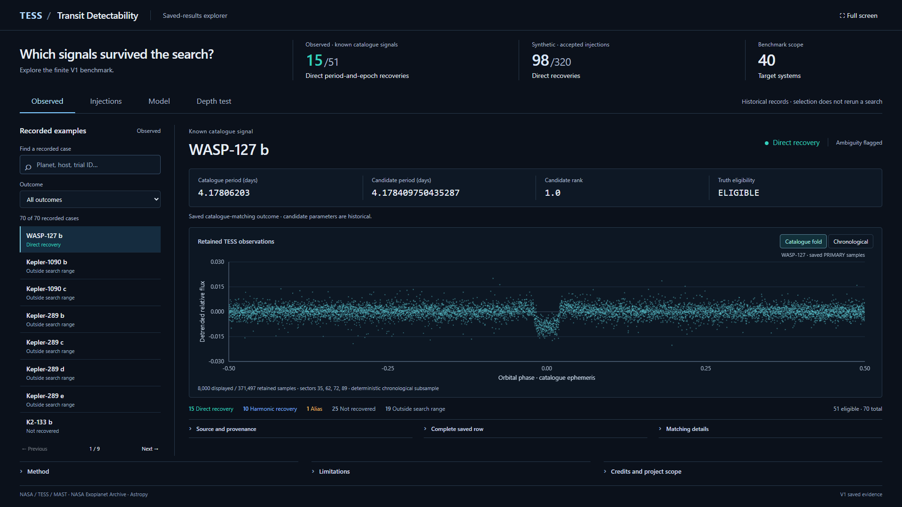

# TESS Transit Detectability

**When can a transit search recover a signal that is present in a TESS light curve?**

This project studies that question using archived observations, known catalogue
signals and synthetic transit injections. It implements light-curve processing,
a blind Box Least Squares (BLS) search, catalogue matching and statistical
detectability modeling, with a small runnable example and an explorer of the
saved results.

## Preview

[](docs/media/wasp127.png)

The same 8,000 saved WASP-127 samples in chronological and catalogue-folded
coordinates. These are processed TESS observations, not a fitted or simulated
transit. The saved recovery carries an ambiguity flag.

[](docs/media/synthetic-trials.png)

The accepted 40-host × 8-injection experiment: 98 direct, 25 additional
harmonic, 12 alias and 185 nonrecovered outcomes. Open the image at full
resolution for individual trial labels. [Image provenance](docs/MEDIA.md)
records the source hashes and display transformations.

<details>
<summary>Working saved-results explorer</summary>

[](docs/media/explorer.png)

A genuine browser capture. Selecting a case reads saved records; the Depth
test tab executes the small normalization example.

</details>

## What the pipeline does

1. Read TESS light curves, apply deterministic quality/time handling, and
   normalize and detrend each segment.
2. Run a blind BLS search and retain separated candidate peaks before
   consulting catalogue truth.
3. Match periods and epochs, recording direct, harmonic, alias and
   nonrecovery outcomes.
4. Construct sampled transit models, normalize their depth and inject them
   into observed substrates; model recovery with target-grouped validation.

## Finite-benchmark results

| Experiment | Direct recovery | Full accounting |
|---|---|---|
| Known catalogue signals | **15/51 eligible** | 15 direct + 10 harmonic + 1 alias + 25 nonrecovered; 19 additional entries outside the search range |
| Accepted synthetic injections | **98/320** | 98 direct + 25 harmonic + 12 alias + 185 nonrecovered |

Synthetic direct-or-harmonic recovery is **123/320**, including the same 98
direct recoveries. The experiments have different denominators. Model
validation used eight folds grouped by target across 40 hosts.

## A failure and its correction

Multiplying a near-unity transit model into zero-centered residuals did not
insert the intended depth. Restoring the baseline fixed that equation, but
the raw limb-darkened model still missed the requested sampled depth.

The correction scales the sampled decrement:
`M_norm = 1 - delta_requested * (1 - M_raw) / delta_raw`, then injects it as
`(1 + residual) * M_norm - 1`. The rejected 320-case depth preflight was a
validation failure with no BLS executions, not 320 failed detections.
[Development notes](docs/DEVELOPMENT.md) preserve the failure and correction.

## Run locally

Use **Python 3.12**. From the repository root, run in PowerShell:

```powershell
python -m venv .venv
.venv\Scripts\python.exe -m pip install --index-url https://pypi.org/simple ".[test]"
.venv\Scripts\python.exe examples/normalize_depth.py
.venv\Scripts\python.exe -m pytest -q
.venv\Scripts\python.exe scripts/verify_project.py
.venv\Scripts\python.exe demo/serve_demo.py
```

Installation builds **this local project** and obtains its declared
dependencies from PyPI. The example calls the original normalization function
on five synthetic samples at 0, 100 and 500 ppm and reports realized depth
and numerical error. Open [the explorer](http://127.0.0.1:8783/index.html)
after the last command; stop it with Ctrl+C. Saved records also work by
opening `demo/index.html` directly, with live calculation unavailable.
[Getting started](docs/GETTING_STARTED.md) explains the output and commands.

## Source and saved evidence

See the [source guide](docs/SOURCE_GUIDE.md), [methods](docs/METHODS.md),
[verification](docs/VERIFICATION.md) and [data provenance](DATA_SOURCES.md).
Algorithms live in `src/`, examples in `examples/`, focused tests in `tests/`,
and selected saved evidence in `results/` and `data/records/`. The
[historical archive](archive/README.md) retains earlier records.

## Scientific limitations

These are finite, selected benchmark results and internally validated models,
not population completeness, external validation or a new planet discovery.
Exact originating-literature mappings for five catalogue parameter classes
are missing from the saved metadata. V2 science and C2 qualification remain
unfinished. See [limitations](docs/LIMITATIONS.md) for the scope of the code,
data and reproducibility evidence.

## Credits and licensing

Observations come from NASA/TESS/MAST and catalogue metadata from the NASA
Exoplanet Archive. The implementation uses Astropy, NumPy, pandas and SciPy.
See [acknowledgments](ACKNOWLEDGMENTS.md) and [license boundaries](LICENSE)
for software, original analysis and external-data rights.
