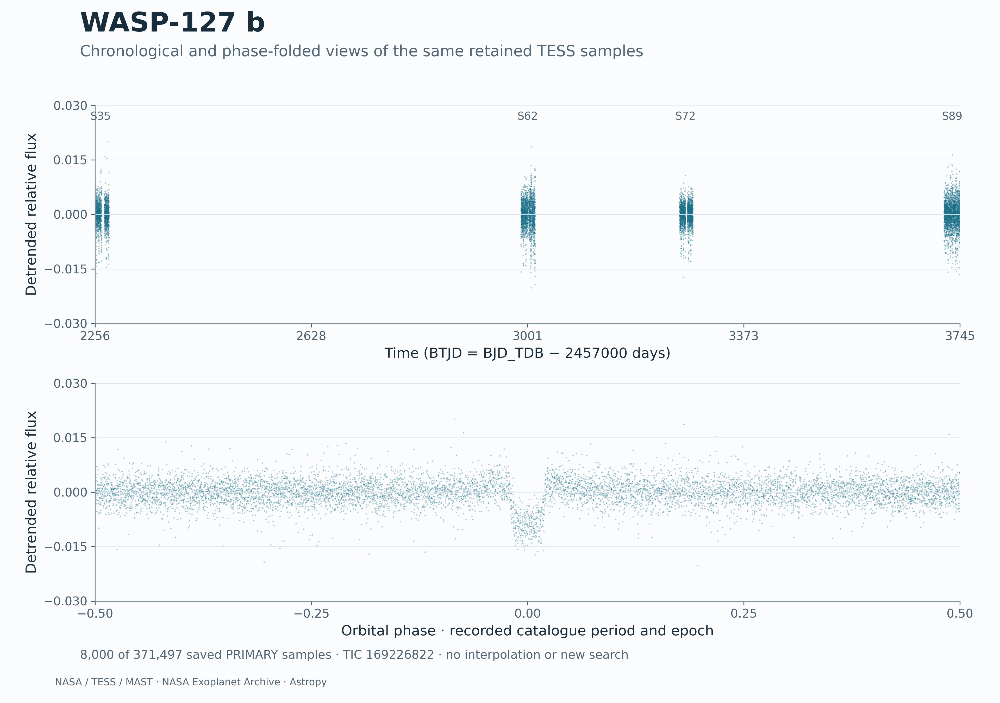
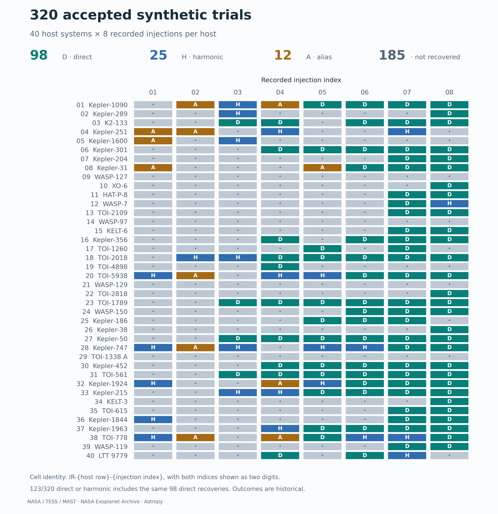
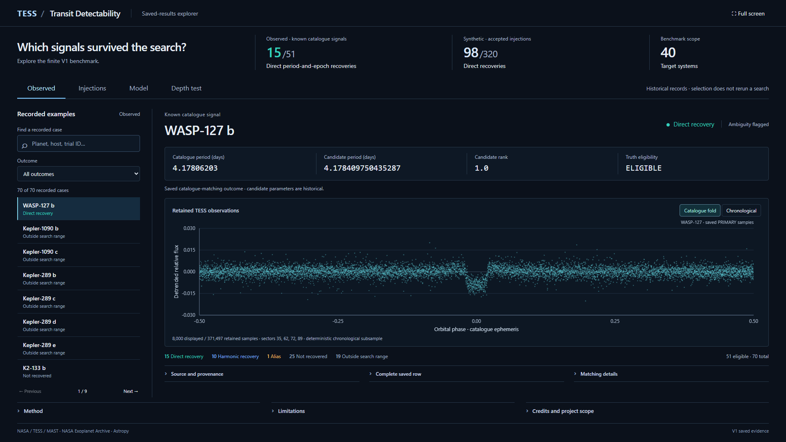

# TESS Transit Detectability

**When can a transit search recover a signal that is present in a TESS light curve?**

I investigated signal recovery in archived TESS observations using known
catalogue signals and synthetic transit injections. The project includes
light-curve processing, blind Box Least Squares (BLS) searches, catalogue
matching, statistical modeling and an explorer of the saved results.

## Preview

[](docs/media/wasp127.png)

The same 8,000 processed TESS observations in chronological and catalogue-folded
coordinates. The saved WASP-127 recovery carries an ambiguity flag.

[](docs/media/synthetic-trials.png)

All 320 accepted synthetic trials, arranged by host and injection index.
Open the full-resolution image to read each trial label.
[Preview notes](docs/MEDIA.md) explain the data and display choices.

<details>
<summary>Working saved-results explorer</summary>

[](docs/media/explorer.png)

A browser capture of the explorer. Select a saved case or use Depth test
to run the small normalization example.

</details>

## What the pipeline does

1. Read TESS light curves, apply deterministic quality/time handling, and
   normalize and detrend each segment.
2. Run a blind BLS search and retain separated candidate peaks before
   consulting catalogue truth.
3. Match periods and epochs, recording direct, harmonic, alias and
   nonrecovery outcomes.
4. Construct sampled transit models, normalize their depth and inject them
   into observed substrates; model recovery with target-grouped validation.

## Finite-benchmark results

| Experiment | Direct recovery | Full accounting |
|---|---|---|
| Known catalogue signals | **15/51 eligible** | 15 direct + 10 harmonic + 1 alias + 25 nonrecovered; 19 additional entries outside the search range |
| Accepted synthetic injections | **98/320** | 98 direct + 25 harmonic + 12 alias + 185 nonrecovered |

Synthetic direct-or-harmonic recovery is **123/320**, including the same 98
direct recoveries. The experiments have different denominators. Model
validation used eight folds grouped by target across 40 hosts.

## A failure and its correction

Multiplying a near-unity transit model into zero-centered residuals did not
insert the intended depth. Restoring the baseline fixed that equation, but
the raw limb-darkened model still missed the requested sampled depth.

The correction scales the sampled decrement:
`M_norm = 1 - delta_requested * (1 - M_raw) / delta_raw`, then injects it as
`(1 + residual) * M_norm - 1`. The 320-case depth check failed before any
BLS search; these were not 320 failed detections.
[Development notes](docs/DEVELOPMENT.md) explain what went wrong and how
the correction was checked.

## Follow the investigation

- The [handwritten research notebook](docs/TESS_Engineering_Notebook.pdf) contains my original working calculations, diagrams, and corrections.
- Target selection follows the [original protocol](docs/original/TARGET_SELECTION_PREREGISTRATION_v1_1_0.md) and [execution report](docs/original/TARGET_SELECTION_EXECUTION_REPORT.md).
- The [first failure record](results/development/injection_recovery_failure_v1_0_0.json) and [development notes](docs/DEVELOPMENT.md) explain the injection problem.
- The [failed depth preflight](results/development/injection_recovery_amendment_failure_v1_0_1.json) led to the [sampled-depth correction](docs/original/INJECTION_MODEL_NORMALIZATION_DERIVATION.md).
- Inspect the [accepted injection outcomes](data/records/injection_recovery_results_v1_0_2.csv) and [verification scope](docs/VERIFICATION.md).

## Run locally

Use **Python 3.12**. From the repository root, run in PowerShell:

```powershell
python -m venv .venv
.venv\Scripts\python.exe -m pip install --index-url https://pypi.org/simple ".[test]"
.venv\Scripts\python.exe examples/normalize_depth.py
.venv\Scripts\python.exe -m pytest -q
.venv\Scripts\python.exe scripts/verify_project.py
.venv\Scripts\python.exe demo/serve_demo.py
```

The example calls V1 normalization on five synthetic samples at 0, 100 and
500 ppm and reports the depth and numerical error. Open
[the explorer](http://127.0.0.1:8783/index.html) after the last command and stop
the server with Ctrl+C. Saved records also open directly from `demo/index.html`.
[Getting started](docs/GETTING_STARTED.md) explains both modes.

## Explore the code and results

The [source guide](docs/SOURCE_GUIDE.md), [methods](docs/METHODS.md) and
[data sources](DATA_SOURCES.md) describe the implementation and evidence.
The [historical archive](archive/README.md) preserves the original records.
See [verification](docs/VERIFICATION.md) for checks you can run.

## Scientific limitations

These are finite, selected benchmark results and internally validated models,
not population completeness, external validation or a new planet discovery.
Exact originating-literature mappings for five catalogue parameter classes
are missing from the saved metadata. V2 science and C2 qualification remain
unfinished. See [limitations](docs/LIMITATIONS.md) for the scope of the code,
data and reproducibility evidence.

## Credits and licensing

Observations come from NASA/TESS/MAST and catalogue metadata from the NASA
Exoplanet Archive. The implementation uses Astropy, NumPy, pandas and SciPy.
See [acknowledgments](ACKNOWLEDGMENTS.md) and [license boundaries](LICENSE)
for software, original analysis and external-data rights.
