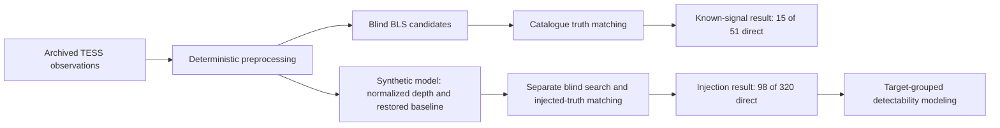

# Methods and interpretation

## Targets and light curves

The question was about **recoverability**, not finding new planets. I used two tests: a blind search for previously catalogued signals, and synthetic transits inserted into processed TESS observations. The two tests have different denominators.

The selected benchmark covers 40 host systems, with four catalogue-predicted difficulty strata and nine stratification dimensions. Including different predicted difficulties makes it possible to examine where a search struggles; this is **not** a random sample of TESS planets. The catalogue-only selection used seed `20260722`: 3,596 candidate systems, 3,593 eligible, 40 selected primaries and 12 alternates, with one host per download unit. The original [selection protocol](original/TARGET_SELECTION_PREREGISTRATION_v1_1_0.md) and [execution report](original/TARGET_SELECTION_EXECUTION_REPORT.md) record the rules. Observations came from MAST and catalogue parameters from the NASA Exoplanet Archive.

For each light curve, the reader prefers SPOC PDCSAP flux when at least 50% of the relevant values are finite, otherwise applying the same rule to SAP flux. Preprocessing keeps quality-zero measurements, sorts and resolves duplicate times, records gaps, and normalizes usable segments by their median minus one. A centered 0.5-day rolling median then removes slow trends. Because that detrending does not protect transits or clip outliers, it can also attenuate the signals being searched for.

## Blind search and recovery criteria

A blind search is useful only if it does not already know the catalogue answer. The search therefore runs Astropy's unweighted `BoxLeastSquares` first and retains up to ten separated candidate peaks; catalogue periods and epochs are consulted **afterward**. The search spans periods from 0.3 days to `min(30 days, baseline/2)`, with a uniform-frequency grid of 2,000–12,000 points. Durations are `[0.04, 0.06, 0.09, 0.13, 0.18, 0.25, 0.35]` days, restricted to less than 20% of the trial period.

A match must account for more than a nearby period. `compare_pair` tests period ratios in this order: 1, 1/2, 2, 1/3, 3, 2/3, 3/2. Its phase-drift measure is `abs(P_candidate - P_expected) * baseline / P_expected**2`, with tolerance 0.25. The circular epoch difference must be within 1.5 catalogue transit durations, or 5% of the catalogue period when duration is missing. Missing catalogue epochs cannot pass that check. The duration ratio 0.5–2 is recorded as a diagnostic, not as another requirement for direct recovery.

The matcher also labels possible daily/window aliases when frequencies differ by about 1, 2 or 3 cycles/day (within `1/baseline`). Candidates are assigned to catalogue signals one-to-one in a fixed order. Keeping harmonic and alias matches separate from **direct period-and-epoch recovery** avoids counting an incorrect period as a direct success.

## Synthetic injections and depth

Synthetic transits give the search a known input whose recovery can be checked. The empirical profile assumes a central, circular transit, quadratic limb darkening (`u1 = 0.30`, `u2 = 0.20`), five-sample exposure averaging and the recorded ingress rule. It is not a full physical transit solver.

The first injection multiplied a near-unity model into zero-centered residuals, so it failed to add the intended transit. Restoring the baseline fixed that part, but a separate preflight found sampled depths approximately 15.38% larger than requested. The corrected model measures `delta_raw = max(1 - M_raw)` on the **retained timestamps** and sets `M_norm = 1 - delta_requested * (1 - M_raw) / delta_raw`. A zero requested depth gives unity. Invalid raw depths and substantially negative models raise errors. The injected residual becomes `(1 + d) * M_norm - 1`. The [derivation](original/INJECTION_MODEL_NORMALIZATION_DERIVATION.md) and [development notes](DEVELOPMENT.md) show the correction.

A trial is considered observable only with at least two observed transit events, five in-transit samples and out-of-transit samples between events. The planning SNR estimate is `depth_ppm * 1e-6 * sqrt(N_in) / scatter`; it assumes white noise and is **not** the BLS detection statistic.

The accepted synthetic experiment yielded **98 direct, 25 harmonic, 12 alias and 185 nonrecoveries** among 320 trials. Separately, the known-signal benchmark yielded **15 direct, 10 harmonic, 1 alias and 25 nonrecoveries** among 51 eligible catalogue signals; 19 more fell outside the search range.

## Detectability modeling

I used the accepted trial outcomes to examine which recorded signal properties were associated with recovery. The historical analysis fitted SciPy **L2-penalized logistic models**, not a completed hierarchical Bayesian model. Model A uses log SNR, log period, observed transit count, TESS magnitude, sector count, log baseline, cadence and difficulty indicators; Model B instead uses log depth and log in-transit point count for its signal/count terms.

Eight validation folds keep every host together, so injections from one system do not appear on both sides of a training/validation split. Continuous predictors are scaled using training-fold values. The recorded workflow also evaluated selected interactions and target-cluster bootstrap intervals.

Two implementation limitations remain: the numeric-cadence sensitivity branch centers cadence separately in each supplied frame, and the historical AUC helper does not average tied probability ranks. The saved fold assignments, out-of-fold predictions, performance and calibration tables allow inspection; [verification](VERIFICATION.md) recomputes counts and selected metrics.

These results describe this finite benchmark. They do not establish external validation, population completeness or a planet discovery. The archived bibliography has five unresolved classes of originating-literature references (see [limitations](LIMITATIONS.md#missing-catalogue-references)). V2 and C2 work remains unfinished.
