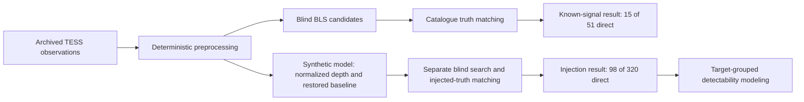

# Methods and interpretation

## Data and selection

V1 used a fixed, selected benchmark of 40 targets and archived TESS light
curves from MAST. Catalogue truth came from the NASA Exoplanet Archive.
Selection used one host system per download unit, four catalogue-predicted
difficulty strata, nine stratification dimensions and seed 20260722. The
catalogue-only reconstruction recorded 3,596 candidates, 3,593 eligible
systems, 40 primaries and 12 alternates. See the original
[selection report](original/TARGET_SELECTION_EXECUTION_REPORT.md) and
[preregistration](original/TARGET_SELECTION_PREREGISTRATION_v1_1_0.md).
The 70 catalogue entries are not a random sample of the sky. The historic
selection and acquisition evidence is separate from the small records bundled
here; no new observation is acquired by installation, tests or the demo.
The preserved [source bibliography](../archive/2026-07-25/docs/SOURCE_SPECIFIC_BIBLIOGRAPHY_V1_0_0_RC2.md)
and [data-source notes](../DATA_SOURCES.md) document upstream sources.

The historical bibliography is explicitly partial: planet identity/target
metadata, orbital periods, transit epochs, planet radii/depths and stellar
parameters lack saved row-and-parameter originating-literature mappings.
Database attribution is established; exact literature provenance for those
five classes is not. The [original citation ledger](../archive/2026-07-25/results/tables/source_specific_bibliography_v1_0_0_rc2.csv)
preserves those unresolved statuses. No references were inferred from current
catalogue values or discovery papers. Closing this gap requires authenticated
original reference metadata; a newly retrieved catalogue would need separate
dating and would not prove what the historical snapshot consumed.

The reader uses SPOC PDCSAP flux where its finite coverage reaches 50%, with
SAP fallback under the same structural rule. It retains decisions explicitly.
Preprocessing sorts time, handles duplicates deterministically, records gaps,
keeps quality zero, and normalizes each usable segment by its median minus
one. The primary detrending is a centered, additive rolling median with a
0.5-day window. It has no transit protection or outlier clipping. Its
zero-centered output and any attenuation introduced by detrending matter to
interpretation. FITS columns and synthetic fixtures are exercised by tests;
the archive of astronomical FITS/Parquet inputs is not bundled.

## Blind search and catalogue matching

The unchanged `bls_search.run_blind_search` uses unweighted Astropy
`BoxLeastSquares`, with no catalogue-truth argument. Period limits are 0.3
days to `min(30 days, baseline/2)`. A uniform-frequency grid is capped at
12,000 points (minimum 2,000), with duration values
`[0.04, 0.06, 0.09, 0.13, 0.18, 0.25, 0.35]` days and duration less than 20%
of period. Ten separated local peaks are retained before truth matching.

`compare_pair` checks ratios in precedence order: 1, 1/2, 2, 1/3, 3, 2/3,
3/2. Phase drift is `abs(P_candidate - P_expected) * baseline/P_expected**2`,
with tolerance 0.25. The epoch offset is circular; tolerance is 1.5 catalogue
durations or 5% of the truth period when duration is unavailable. Missing
epochs do not pass the epoch criterion. Duration ratio 0.5–2 is recorded as
a diagnostic; it is not silently added as a new primary success gate.
Frequency differences near 1, 2 or 3 cycles/day within `1/baseline` can receive
the alias label. `match_target` applies the recorded deterministic one-to-one
assignment order. Harmonic labels are secondary; the primary endpoint
requires the direct period assignment and epoch agreement.

## Synthetic injection and sampled depth

The empirical model represents a central circular transit with quadratic
limb-darkening coefficients 0.30 and 0.20, finite exposure averaging with five
samples, and its recorded ingress prescription. It is a modeling assumption,
not a complete physical transit solver. The [original normalization derivation](original/INJECTION_MODEL_NORMALIZATION_DERIVATION.md)
defines depth on retained timestamps, not an unobserved continuous minimum.
For positive requested depth the original function rescales the decrement;
for zero it returns unity. Nonfinite/degenerate raw depths and substantially
negative normalized models fail explicitly. The supplied code retains the
original edge behavior rather than claiming new input-domain guarantees.

`inject_baseline_restored` computes `(1 + d) * M_norm - 1`. The original
`inject_multiplicatively` remains visible to explain the failed substrate
assumption. `observability` requires at least two observed events, five
in-transit samples and out-of-transit samples between events. The SNR adapter
preserves the planning expression `depth_ppm * 1e-6 * sqrt(N_in)/scatter`.
It is a white-noise proxy; correlated stellar or instrumental noise can break
its interpretation. It is not the BLS depth/error statistic.

The accepted records have 98 direct + 25 harmonic + 12 alias + 185
nonrecovered = 320. The known-signal records separately have 15 + 10 + 1 + 25
= 51 eligible and 19 outside range. [Verification](../scripts/verify_project.py)
recomputes this accounting from saved rows rather than repeating searches.

## Target-grouped modeling

The historical implementation used the preregistered SciPy L2-penalized
logistic fallback, not a fitted Bayesian hierarchical model. Model A uses
log SNR, log period, observed transit count, TESS magnitude, sector count,
log baseline, cadence indicator and difficulty indicators. Model B replaces
the signal/count terms with log depth and log in-transit points. Selected
interaction terms and target-cluster bootstrap intervals were part of the
historical workflow. Eight validation folds kept each target together;
primary continuous predictors use training-fold means and scales.

The extracted `modeling.py` retains the original functions. The new
`grouped_validation.grouped_cv` checks supplied fold assignments before
calling them. The numeric-cadence sensitivity branch in the original `design`
centers cadence separately per frame; it is preserved and disclosed, and is
not exposed by the primary public wrapper. The historical AUC helper does
not average tied probability ranks. These are source limitations, not
silently corrected historical results. No full fit, bootstrap or sensitivity
study is rerun in this release preparation.

The included fold table, out-of-fold predictions, performance and calibration
tables support inspection of the saved analysis. They do not prove
out-of-sample performance on other targets, false-alarm calibration,
population completeness, or a planet discovery. V2 and C2 remain open.
